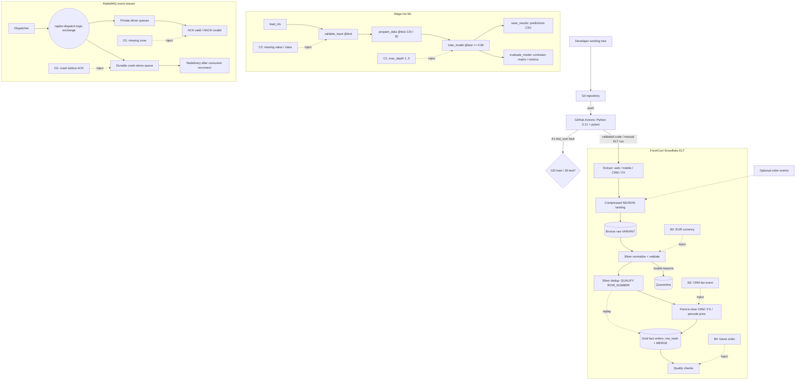

# Architecture — Break It Till It Holds

## Detection boundaries

- **A1:** `pytest` checks the instructor's 80/20 split in local CI.
- **B2:** `ARRAY_CONSTRUCT_COMPACT` builds reason codes; `silver.orders_clean` excludes rows
  with reasons and the quarantine insert stores each source version once.
- **B1:** Silver chooses one order version; Gold `MERGE` changes only when `row_hash` changes.
- **B3:** SCD2 intervals select the customer tier effective on the order date.
- **B4:** `quality_checks()` reports future-dated deduplicated orders.
- **C1/C2:** Mage `@test` functions stop downstream blocks when their output contract fails.
- **D1:** consumers NACK malformed messages with `requeue=False`; D2 demonstrates broker
  redelivery for an unacknowledged message after process death.
